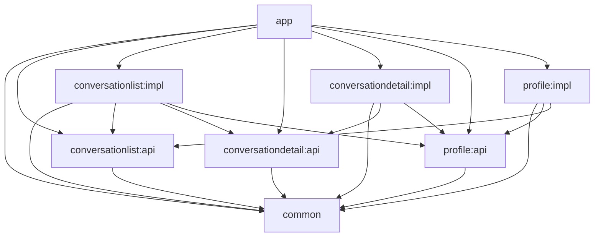

# Hybrid navigation with Hilt and real Gradle modules

This runnable app demonstrates gradual migration from multiple Activities to Compose Navigation 3 across eight Gradle modules. It uses the repository's existing settings, version catalog, repositories, and Gradle wrapper. Open the repository root in Android Studio; this folder is not a separate Gradle build.

```text
modular_hilt/
├── app/                 Android application, launcher, NavDisplay, start destination
├── common/              AppNavKey, NavigatorFactory, Navigator, launcher bindings
├── conversationlist/
│   ├── api/             ConversationList key
│   └── impl/            List screen, Nav3 entry, conversation deep link matcher
├── conversationdetail/
│   ├── api/             ConversationDetail key and conversation URI constant
│   └── impl/            Legacy detail Activity, screen, launcher binding
└── profile/
    ├── api/             Profile route and URI constant
    └── impl/            Screen, entry registration, deep link matcher
```

The application ID is `com.example.nav3recipes.modularhilt`, so this app can be installed alongside the original recipes app. Choose the `modular_hilt.app` run configuration (or create an Android App configuration for `:modular_hilt:app`) and launch **Modular Hilt**. This recipe runs from its own launcher rather than the main recipes app's picker.

## Dependencies enforced by Gradle



Every box is a Gradle project prefixed with `:modular_hilt:`. The `common` module has no feature dependencies. API modules depend on `common` for `AppNavKey` and expose serializable navigation keys and URI constants. They never reference Activity classes, screen implementations, or feature implementation modules. Implementation modules depend on APIs, never on another implementation. Their Hilt modules are `internal` and their screen composables are private or internal to their implementation module.

`conversationlist:impl` knows only the detail key from `conversationdetail:api`; it has no dependency on the detail implementation or `ConversationDetailActivity`. `conversationdetail:impl` depends on its own API, `profile:api`, and `common`. It does not depend on the list feature. Both list and detail navigate to `Profile` through `profile:api`. `profile:impl` depends on `conversationlist:api` to declare its deep link parent. These references produce no Gradle cycle.

Each conversation implementation keeps its small display palette local. Neither implementation shares display models or utilities with the other, and presentation details stay out of the public keys and common navigation module.

The app includes all three feature implementations so Hilt can discover their bindings, but its Kotlin code only references APIs and common navigation infrastructure. Adding a feature requires including its implementation dependency; no central screen registry needs editing.

## How the pieces meet at runtime

`AppNavKey` extends both Nav3's `NavKey` and Java `Serializable`: Kotlin serialization supports URI matching, and Java serialization transports keys in Activity Intent extras. The feature APIs name destinations without deciding whether they are Compose screens or Activities.

Hilt installs navigation bindings in `SingletonComponent`. The list and profile implementations contribute a `NavEntryInstaller` and a `BackStackMatcher` through `@IntoSet`. The detail implementation contributes only a `LegacyActivityLauncher` through `@IntoMap`, keyed by `@NavKeyClass(ConversationDetail::class)`. The conversation deep link matcher belongs to the list implementation because it combines the list parent key with the detail key using only their APIs. The common module declares empty multibindings so registries can also be empty.

`NavigatorFactory` creates a navigator for each Activity. The navigator holds that Activity only for its lifetime; singleton installers receive the current navigator as an argument rather than capturing an injected Activity. The host supplies its observable Nav3 stack to the factory. The legacy detail Activity supplies no stack.

Every call to `navigator.goTo(key)` follows the same rules:

| Destination and caller | Result |
| --- | --- |
| Key has a legacy launcher | Launch its Activity, passing the key in extras |
| No legacy launcher, caller has a Nav3 stack | Push the key onto that stack |
| No legacy launcher, caller has no Nav3 stack | Open a host through package-scoped `ACTION_OPEN_NAV3_HOST`, passing the key |

`ConversationList` and `Profile` are Nav3 entries. `ConversationDetail` has only a legacy launcher, so it never enters `NavDisplay`. The list offers both conversation items and an **Open Profile** button. Both the legacy detail and Profile offer **Back** buttons using `navigator.goBack()`.

The launcher is `HiltModularActivity`, initially showing `ConversationList`. Clicking a conversation and then **Open Profile** creates this Android task stack:

```text
HiltModularActivity [ConversationList]
    -> ConversationDetailActivity (id)
        -> HiltModularActivity [Profile]
```

The second host starts with only `Profile`. Back finishes it, then Back finishes the legacy detail, revealing the original list. The host uses `singleTop`, not `singleTask`, and the navigator sets no `CLEAR_TOP` flags, so navigating from a legacy Activity preserves the Activities underneath. Navigating directly from the list to Profile instead pushes onto the existing host's Nav3 stack.

## Deep links and saved state

Use **Deep link examples** in the host to open `HiltDeepLinkActivity`. Its existing buttons demonstrate both feature URIs. On a fresh URI launch, the host uses the feature-contributed matchers to build the synthetic parent stack. A profile URI creates `[ConversationList, Profile]` in Nav3. A conversation URI leaves `[ConversationList]` in the host and launches the legacy detail Activity above it.

An extra key from a legacy Activity takes priority over a URI and is consumed after handling. New intents delivered to an existing top host append their destination through `Navigator`, which also routes legacy keys correctly. Unknown URIs leave the stack unchanged.

The host saves its serializable Nav3 keys in instance state and restores them on recreation without replaying the original Intent. The legacy detail reads its key from its own Intent. Navigators are recreated with their current Activity, so they do not retain destroyed Activity instances.

## Build and try it

Use the same Android SDK and JDK required by the root project (including Android SDK 37.1):

```sh
./gradlew :modular_hilt:app:assembleDebug
./gradlew :modular_hilt:app:installDebug
adb shell am start -n com.example.nav3recipes.modularhilt/.HiltModularActivity
```

Launch either deep link directly with an explicit component; this does not require website association or Android App Links verification:

```sh
adb shell am start -W -a android.intent.action.VIEW \
  -d 'https://www.nav3recipes.com/conversation/7' \
  -n com.example.nav3recipes.modularhilt/.HiltModularActivity
adb shell am start -W -a android.intent.action.VIEW \
  -d 'https://www.nav3recipes.com/profile' \
  -n com.example.nav3recipes.modularhilt/.HiltModularActivity
```

With a device or emulator attached, run the integration tests:

```sh
./gradlew :modular_hilt:app:connectedDebugAndroidTest
```

They check in-process list-to-profile navigation, legacy Activity launch, new-host identity and Android Back ordering, explicit Back buttons, both deep links from the helper, incoming key and URI intents, and stack restoration after recreation. Building the app also runs Hilt generation across the real module boundaries.

## Sample scope

This sample concentrates on Gradle boundaries and hybrid navigation. Host stack restoration uses Android instance state; durable navigation history beyond the lifetime of a task and domain-specific validation of incoming links are outside the sample. Keeping these eight modules together in this folder is for discoverability; the folder itself creates no dependency boundary.
