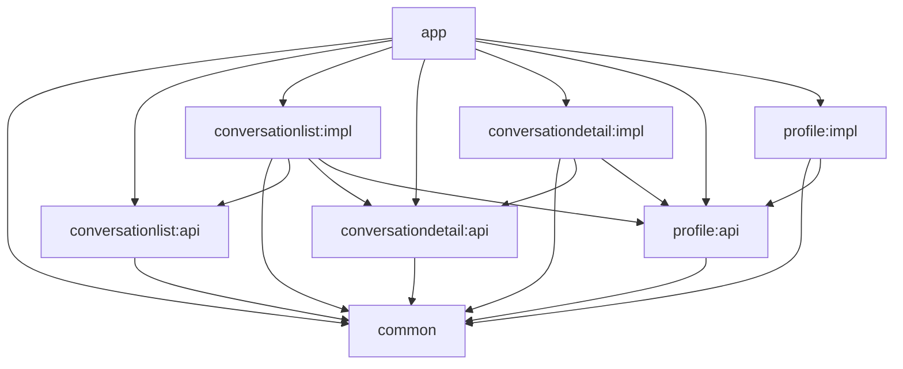

# Stage 1: multi-Activity navigation with Nav3-compatible keys

This runnable sample is the starting point for a gradual migration to Navigation 3. Every feature screen has its own `ComponentActivity` and uses Compose to render its UI. Screen navigation uses Android's Activity task stack. Navigation 3 is used only for the `NavKey` contract inherited by `AppNavKey`; this stage has no Nav3 display, entry registry, deep link matcher, or Compose back stack.

The eight Gradle modules share the root settings, version catalog, repositories, and wrapper. Open the repository root in Android Studio and select `:modular_hilt:app` in an Android App run configuration. The application ID is `com.example.nav3recipes.modularhilt`, so the **Modular Hilt** app can be installed alongside the main recipes app.

```text
modular_hilt/
├── app/                 Application, launcher entry point, deep link demo/router
├── common/              AppNavKey, Navigator, Activity launcher contracts
├── conversationlist/
│   ├── api/             ConversationList key
│   └── impl/            List Activity, screen, Activity launcher binding
├── conversationdetail/
│   ├── api/             ConversationDetail key and URI constant
│   └── impl/            Detail Activity, screen, Activity launcher binding
└── profile/
    ├── api/             Profile key and URI constant
    └── impl/            Profile Activity, screen, Activity launcher binding
```

## Dependencies enforced by Gradle



Every box is a Gradle project prefixed with `:modular_hilt:`. Feature APIs depend on `common` for `AppNavKey` and on Kotlin serialization for their serializable route keys. They contain no Activity references, Hilt bindings, or implementation dependencies. `common` has no feature dependencies.

`conversationlist:impl` depends on `conversationdetail:api` and `profile:api`, so it can navigate without referencing either destination's Activity. `conversationdetail:impl` depends on `profile:api`. `profile:impl` depends only on its own API and `common`. Implementation modules never depend on each other. Each conversation screen keeps its small display palette local.

The app includes all implementations to make their Hilt bindings available. Feature modules navigate only to feature keys; they have no navigation routes into the app module.

## How navigation works

`AppNavKey` extends Nav3's `NavKey` and Java `Serializable`. Feature keys also retain Kotlin serialization annotations. Java serialization transports the key through Activity Intent extras; the API identifies the destination without choosing its UI implementation.

Each feature implementation contributes a `LegacyActivityLauncher` to a Hilt map using `@IntoMap` and `@NavKeyClass`. Launchers create explicit Intents and attach the key under `Navigator.EXTRA_NAV_KEY`. The detail and profile Activities validate their expected keys with `intent.extractNavKey<T>()`.

Every Activity directly injects `@ActivityScoped Navigator`. Hilt's `ActivityComponent` supplies the current Activity and inherits the launcher map from `SingletonComponent`. `navigator.goTo(key)` looks up the key's class and starts its registered Activity; an unregistered key raises an error identifying the missing launcher. `navigator.goBack()` finishes the current Activity. System Back uses the Android task stack as usual.

`HiltDeepLinkActivity` is the MAIN/LAUNCHER entry point. Its **Conversation List** button opens the list through `Navigator`. Clicking a conversation, then **Open Profile**, creates:

```text
HiltDeepLinkActivity
    -> ConversationListActivity
        -> ConversationDetailActivity (ConversationDetail(id))
            -> ProfileActivity (Profile)
```

Back unwinds Profile, Detail, then List, returning to the launcher demo. **Open Profile** on the list creates only `List -> Profile`. The explicit **Back** buttons finish Profile or Detail through the same navigator.

## Deep link examples and external URIs

The launcher demo's buttons navigate to the list, a detail key with the entered integer ID, or Profile. These button launches keep the demo underneath so Back returns to it.

`HiltDeepLinkActivity` also accepts external `ACTION_VIEW` Intents for:

- `https://www.nav3recipes.com/profile`
- `https://www.nav3recipes.com/conversation/{id}`, where `{id}` parses to an `Int`

A supported URI launches the destination through `Navigator` and finishes the router, so Back returns to whatever Activity was underneath it. There is no synthetic list parent on a cold URI launch. Non-VIEW launches display the demo UI; invalid or unsupported URIs also leave the demo visible. New VIEW intents delivered to an existing top demo Activity use the same routing logic. Recreation does not replay an already handled URI.

## Build and run

Use the same JDK and Android SDK as the root project, including Android SDK 37.1. The project still uses its existing Navigation 3 runtime snapshot for `NavKey`.

```sh
./gradlew :modular_hilt:app:assembleDebug
./gradlew :modular_hilt:app:installDebug
adb shell am start -n com.example.nav3recipes.modularhilt/.HiltDeepLinkActivity
```

Explicit components let you test URI routing without website association or Android App Links verification:

```sh
adb shell am start -W -a android.intent.action.VIEW \
  -d 'https://www.nav3recipes.com/conversation/7' \
  -n com.example.nav3recipes.modularhilt/.HiltDeepLinkActivity
adb shell am start -W -a android.intent.action.VIEW \
  -d 'https://www.nav3recipes.com/profile' \
  -n com.example.nav3recipes.modularhilt/.HiltDeepLinkActivity
```

With a device or emulator attached:

```sh
./gradlew :modular_hilt:app:connectedDebugAndroidTest
```

The integration tests check Activity identities and key extras, system and explicit Back behavior, all demo buttons, external URIs, incoming intents, invalid URI handling, and navigation after Activity recreation.

## Moving to the next stage

The route keys and `navigator.goTo(...)` call sites can stay the same when a later stage introduces Nav3 screens. That stage will change routing behind `Navigator` and replace selected Activity bindings with Nav3 entry registrations. This baseline deliberately leaves all screens in Activities so those migration changes can be reviewed separately.
