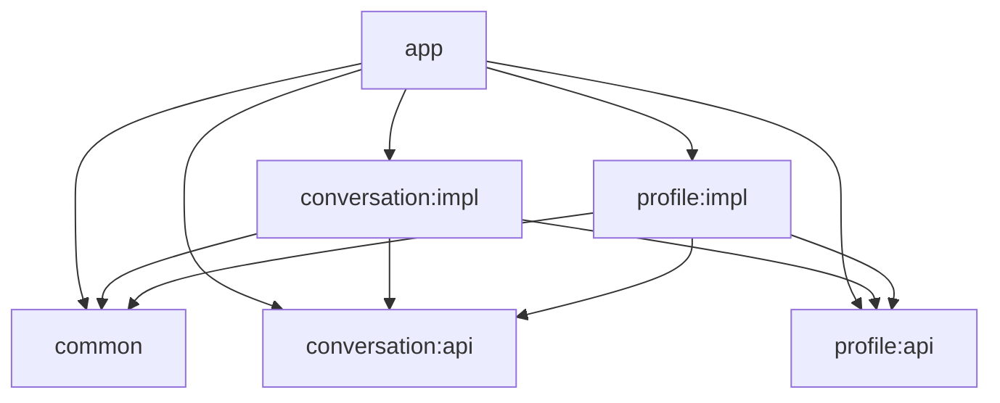

# Modular Hilt navigation: real Gradle modules

This runnable app demonstrates Hilt navigation across six Gradle modules. It uses the repository's existing settings, version catalog, repositories, and Gradle wrapper. Open the repository root in Android Studio; this folder is not a separate Gradle build.

```text
modular_hilt/
├── app/                 Android application, launcher, NavDisplay, start destination
├── common/              Navigator and EntryProviderInstaller
├── conversation/
│   ├── api/             ConversationList, ConversationDetail, URI constant
│   └── impl/            Screens, entry registrations, deep link matcher
└── profile/
    ├── api/             Profile route and URI constant
    └── impl/            Screen, entry registration, deep link matcher
```

The application ID is `com.example.nav3recipes.modularhilt`, so this app can be installed alongside the original recipes app. Choose the `modular_hilt.app` run configuration (or create an Android App configuration for `:modular_hilt:app`) and launch **Modular Hilt**. This recipe runs from its own launcher rather than the main recipes app's picker.

## Dependencies enforced by Gradle



Every box is a Gradle project prefixed with `:modular_hilt:`. The `common` module has no feature dependencies. API modules expose serializable navigation keys and URI constants; they have no screen or Hilt dependencies. Implementation modules depend on APIs, never on another implementation. Their Hilt modules are `internal` and their screen composables are `private`.

`conversation:impl` depends on `profile:api` because its detail screen navigates to `Profile`. `profile:impl` depends on `conversation:api` because its deep link uses `ConversationList` as a parent. These references produce no Gradle cycle. Conversation colors live in its implementation rather than in its public navigation key.

The app includes both implementations so Hilt can discover their bindings, but its Kotlin code only references APIs and common navigation infrastructure. Adding a feature requires including its implementation dependency; no central screen registry needs editing.

## How the pieces meet at runtime

1. `app/AppModule` provides `ConversationList` as the initial `NavKey`.
2. Hilt constructs the activity-retained `Navigator` from this key and the set of deep link matchers contributed by the features.
3. Each feature uses `@IntoSet` to contribute an `EntryProviderInstaller` and a `BackStackMatcher`. Both features install bindings in `ActivityRetainedComponent`.
4. `HiltModularActivity` injects the navigator and installers, applies the installers to `entryProvider`, and passes the navigator's observable stack to `NavDisplay`.
5. Clicking a conversation pushes `ConversationDetail(id)`. Clicking **View Profile** pushes the key from `profile:api`; the profile implementation supplies its UI through its installer.
6. Deep links replace the stack with `[ConversationList, ConversationDetail(id)]` or `[ConversationList, Profile]`. Back therefore returns to the conversation list even after launching directly into a feature.

The launcher provides buttons for normal navigation and both deep links. The navigation activity also accepts external VIEW intents and handles new intents delivered to an existing top activity.

## Build and try it

Use the same Android SDK and JDK required by the root project (including Android SDK 37.1):

```sh
./gradlew :modular_hilt:app:assembleDebug
./gradlew :modular_hilt:app:installDebug
adb shell am start -n com.example.nav3recipes.modularhilt/.HiltDeepLinkActivity
```

Launch either deep link directly with an explicit component; this does not require website association or Android App Links verification:

```sh
adb shell am start -W -a android.intent.action.VIEW \
  -d 'https://www.nav3recipes.com/conversation/7' \
  -n com.example.nav3recipes.modularhilt/.HiltModularActivity
adb shell am start -W -a android.intent.action.VIEW \
  -d 'https://www.nav3recipes.com/profile' \
  -n com.example.nav3recipes.modularhilt/.HiltModularActivity
```

With a device or emulator attached, run the integration tests:

```sh
./gradlew :modular_hilt:app:connectedDebugAndroidTest
```

They check cross-feature navigation, both synthetic deep link stacks, and navigation retention across activity recreation. Building the app also runs Hilt generation across the real module boundaries.

## Sample scope

This example concentrates on Gradle boundaries and Hilt composition. The back stack is held in an activity-retained navigator: it survives configuration changes, but is not persisted across process death. A production app would also need a saved-state policy and any domain-specific validation of incoming links. Keeping these six modules together in this folder is for discoverability; the folder itself creates no dependency boundary.
